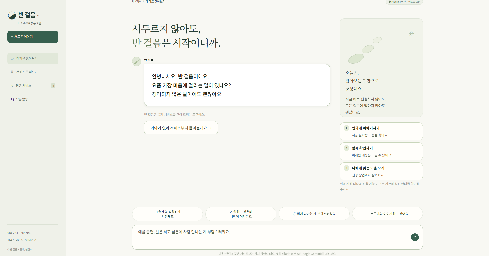
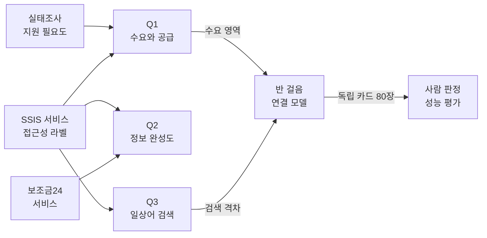
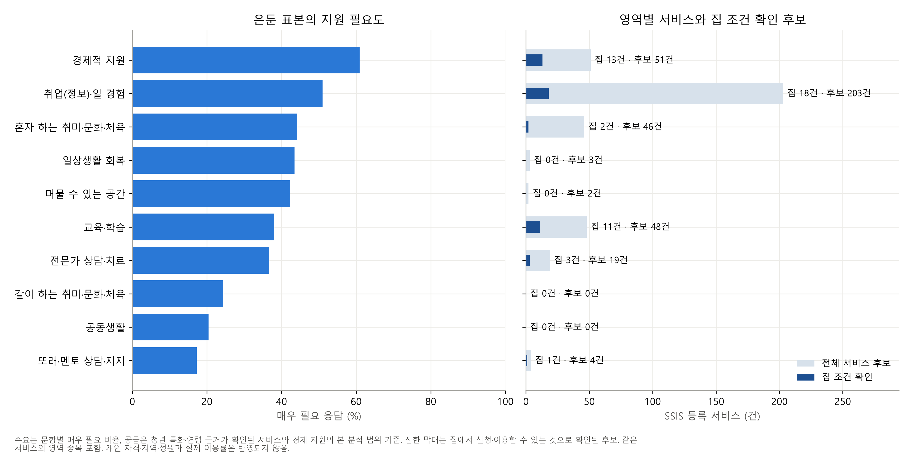
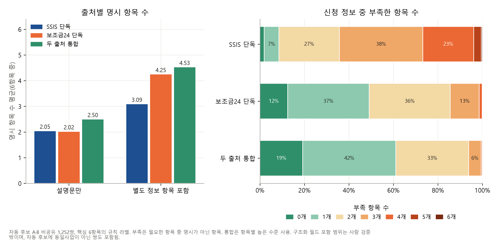

# Bangeoreum: Remote Welfare Access for Isolated Youth

## Overview

고립, 은둔 청년이 복지서비스를 찾고 신청하는 과정의 병목을 분석하고, 일상어 입력에서 외출 부담이 낮은 서비스를 찾는 연결 모델 「반 걸음」을 설계함.

| 분석 질문 | 내용 |
|---|---|
| Q1 | 필요한 지원에 해당하는 서비스가 있고, 집에서 신청하고 이용할 수 있는가 |
| Q2 | 한 플랫폼의 정보만으로 신청에 필요한 정보를 알 수 있는가 |
| Q3 | 같은 상황을 일상어로 적어도 도움이 되는 서비스를 찾는가 |

- 수요는 2023 고립, 은둔 청년 실태조사 응답, 공급은 한국사회보장정보원(SSIS) 등록 서비스로 측정
- 서비스 건수에는 정원, 예산, 실제 이용 인원이 반영되지 않음
- 앱: [banggeoleum.streamlit.app](https://banggeoleum.streamlit.app/)

<p align="center">
  
</p>
<p align="center"><sub>「반 걸음」 첫 화면. 상황을 일상어로 적거나 예시 문장을 고르면 대화로 필요한 지원과 조건을 확인함.</sub></p>


## Data

| 자료 | 기간 | 대상, 단위 | 출처 |
|---|---|---|---|
| 중앙부처, 지자체 복지서비스 | 2026-10-30 수집 | 서비스 5,288건 | 한국사회보장정보원, 공공데이터포털 |
| 보조금24 공공서비스 | 2026-10-31 수집 | 서비스 10,942건 | 행정안전부, 공공데이터포털 |
| 2023 고립, 은둔 청년 실태조사 | 2023 | 은둔 표본 4,448명, 고립 보조집단 3,032명 | 보건복지부, 한국보건사회연구원 |
| 2024 청년의 삶 실태조사 | 2024 | 은둔 정의 문항 근거 | 국무조정실 |
| 검색 평가 자료 | 2026-11 | 질의쌍 30개, 독립 평가 카드 80장 | 팀 작성, 사람 및 기존 AI 판정 |

- 원자료와 전처리 데이터는 저장소에 포함하지 않음. 출처와 배치 경로는 [data/README.md](data/README.md)
- 실태조사 응답 자료는 이용허락 범위에 따라 재배포하지 않음
- 노트북 출력과 결과표에는 집계값만 포함

## Research Design

1. **지원 수요 집계**
   - 2024 청년의 삶 실태조사의 은둔 정의(외출 정도, 은둔 이유)를 2023 실태조사에 적용해 19–34세 은둔 표본 구성
   - 10개 지원 영역의 필요도 문항(Q21)에서 영역별 '매우 필요' 비율 계산
   - 고립 보조집단과는 나이 구성을 맞춘 직접 표준화로 비교

2. **서비스 접근성 분류**
   - SSIS 목록과 상세를 서비스 ID로 병합하고 신청방법, 지원내용, 지원대상 원문에 규칙 적용
   - 신청 방식(온라인, 전화 또는 기관 경유, 방문), 비대면 완결성, 청년 대상 여부, 고립, 은둔 명시 여부를 분류
   - 각 라벨에 근거 문장을 저장하고 근거가 없으면 판정 불가로 둠

3. **플랫폼 정보 비교**
   - 서비스명 유사도로 SSIS와 보조금24의 동일사업 후보 쌍을 찾고 신뢰도가 높은 A, B 등급 1,252쌍 분석
   - 연령, 소득, 신청방법, 신청기간, 구비서류, 문의처 6개 항목의 명시 여부를 규칙으로 판정
   - 실제 동일사업 여부와 값 충돌은 사람이 확인한 사례에서 따로 검토

4. **검색 비교와 연결 모델**
   - 같은 필요를 일상어와 행정어로 표현한 질의쌍 30개의 상위 10개 검색 결과 겹침 측정
   - Kanana-2-3B-Instruct로 욕구, 활동 범위, 나이, 지역을 추출하고 사용자가 확인
   - BM25(키워드 순위)와 BGE-M3(의미 순위)를 RRF(순위 역수 합)로 결합하고 규칙으로 연령, 거주지, 외출 조건 불일치를 제외
   - 위기 표현은 키워드 규칙과 LLM 판정 중 하나라도 감지하면 추천을 멈추고 전문기관 안내

5. **추천 성능 평가**
   - 팀원이 작성한 독립 평가 카드 80장을 개발 자료와 분리해 평가에 사용
   - 최종 버전의 BM25, Dense(BGE-M3), RRF 검색 결과를 80장 사람 판정 기준 Recall@5, Recall@10으로 비교
   - 최종 추천은 사람 판정과 기존 AI 판정을 함께 사용하고, Success@5(64장), 판정된 추천 중 관련 비율, 완전 판정 57장의 Precision@5를 구분해 보고
   - Kanana 추출부터 추천까지의 전체 처리는 80장 원문을 그대로 넣어 위기 판단, 욕구 추출, 추천 결과 확인
   - 기존 32장 검색 비교와 최종 80장 평가는 평가 범위와 지표가 달라 수치를 직접 비교하지 않음

## Analysis Workflow



## Key Results

### Q1. 필요한 지원과 집에서 시작할 수 있는 서비스

- 은둔 표본에서 '매우 필요' 비율은 경제적 지원 **60.9%**, 취업(정보)과 일 경험 51.0%, 혼자 하는 취미, 문화, 체육활동 44.2% 순
- 같은 영역의 서비스 후보 51건, 203건, 46건 중 집에서 신청하고 이용할 수 있다고 원문으로 확인된 서비스는 13건, 18건, 2건
- 일상생활 회복, 머물 수 있는 공간은 후보가 각각 3건, 2건이고 집 조건 확인 서비스 없음
- 신청 방식 판정이 가능한 전체 서비스 4,532건 중 방문 또는 면접 58.8%, 청년 대상 579건 중 44.2%
- 고립, 은둔을 원문에 명시한 서비스는 전체 5,288건 중 19건(0.36%)

<p align="center">
  
</p>
<p align="center"><sub>왼쪽은 은둔 표본(4,448명)의 문항별 '매우 필요' 비율, 오른쪽은 영역별 서비스 후보와 집 조건 확인 후보. 같은 서비스가 여러 영역에 포함되며 개인 자격, 지역, 정원은 반영되지 않음.</sub></p>

### Q2. 한 플랫폼의 정보만으로 신청을 준비할 수 있는가

- 핵심 6항목을 모두 명시한 비율은 SSIS 1.9%, 보조금24 12.5%, 두 출처 통합 **19.2%** (1,252쌍)
- 별도 정보 항목까지 포함한 평균 명시 항목 수는 SSIS 3.09개, 보조금24 4.25개, 통합 4.53개
- 두 출처를 합치면 명시 항목이 늘지만 81%의 쌍에서 1개 이상의 항목이 여전히 부족함
- 자동 후보 쌍에는 동일사업이 아닌 쌍도 포함되며, 항목 판정은 규칙 라벨임

<p align="center">
  
</p>
<p align="center"><sub>SSIS와 보조금24의 자동 후보 A, B 등급 1,252쌍. 왼쪽은 핵심 6항목 중 평균 명시 항목 수, 오른쪽은 부족 항목 수별 쌍의 비율.</sub></p>

### Q3. 일상어 입력으로 도움이 되는 서비스를 찾는가

- 일상어와 행정어 질의쌍 30개의 상위 10개 목록에서 평균 공통 서비스는 0.87개, 공통 서비스가 없는 쌍은 21개(서비스명, 요약, 대상 기준)
- 최종 버전의 독립 평가 카드 80장 사람 판정 기준 Recall@5는 BM25 **0.218**, Dense 0.222, RRF **0.547**
- Recall@10은 BM25 0.283, Dense 0.309, RRF **0.711**
- 별도 42개 질의의 Recall@100은 BM25 0.808, RRF 0.879
- 재현율은 평가에서 판정한 관련 서비스 기준이며 전체 서비스 기준 재현율이 아님

| 검색 방식 (80장, 사람 판정) | Recall@5 | Recall@10 |
|---|---:|---:|
| BM25 (키워드) | 0.218 | 0.283 |
| Dense (BGE-M3 의미) | 0.222 | 0.309 |
| RRF (결합) | **0.547** | **0.711** |

#### Kanana 포함 전체 처리 및 최종 추천

| 항목 | 결과 |
|---|---:|
| 위기 재현율, 오탐 (80장) | 8/8, 0/72 |
| 욕구 영역 F1 (위기 아닌 72장) | 0.675 |
| 주욕구 정확도 | 0.609 |

| 최종 추천 (사람 + 기존 AI 판정) | 결과 |
|---|---:|
| Success@5 (64장) | **33/64 (51.6%)** |
| 판정된 추천 중 관련 비율 | 0.460 |
| 완전 판정 57장 Precision@5 | **0.260** |
| 자격·접근 규칙 위반 | 0 / 0 |

- 카드 원문만 Kanana-2-3B-Instruct에 넣어 위기 판단부터 추천(최대 5개)까지 앱과 같은 경로로 실행
- 검색 방식 비교표는 사람 판정 기준이고, 최종 추천표는 사람 판정과 기존 AI 판정을 함께 사용한 결과임
- 판정된 추천 중 관련 비율과 완전 판정 57장의 Precision@5는 분모가 다르므로 구분해 해석함
- 수치는 제공된 최종 버전(`f1ee436`) 성능 비교표 기준임. 기존 [32장 검색 방식 비교](docs/Q3_FINAL_EVALUATION_2026-11-17.md)와 [Kanana 전체 검증](docs/Q3_KANANA_E2E_2026-11-18.md)은 이전 평가 기록임

## Limitations

- 수요 조사와 공급 자료는 시점과 단위가 달라 개인에게 공급이 충분한지 직접 측정할 수 없음
- 실태조사 표본은 비가중, 비확률 표본이라 전체 청년의 필요도로 일반화하기 어려움
- 접근성 라벨은 API 원문에 의존하며 본인 인증, 서류 준비 같은 실제 신청 부담은 반영하지 못함
- 검색 방식 비교와 전체 처리 검증은 독립 평가 카드 80장 규모이며, 최종 추천 지표는 64장 또는 완전 판정 57장 등 지표별 평가 범위가 다름. 실제 청년과 복지 실무자 대상 사용성 검증은 수행하지 않음
- 모델 성능은 평가 시점의 결과이며 추출, 검색어 생성, 추천 단계는 개선 과정에 있음

## Repository Structure

```text
.
├── notebooks/   # STEP 00–05 단계 분석과 최종 노트북(FINAL_bangeoreum)
├── src/         # 수집, 전처리, 라벨링, Q1–Q3 분석 코드
├── ai/          # 「반 걸음」 모델과 Streamlit 앱
├── deploy/      # Streamlit 배포 진입점
├── outputs/     # 단계별 결과표와 그림
├── logs/        # 검수, 검증 기록
├── docs/        # 평가 결과, 설계, 데이터 규격 문서
└── data/        # 데이터 배치 안내(원자료 미포함)
```

- 최종 분석: [notebooks/FINAL_bangeoreum.ipynb](notebooks/FINAL_bangeoreum.ipynb)
- 앱 실행과 모델 구성: [ai/README.md](ai/README.md)
- Q3 이전 평가 기록: [32장 검색 방식 비교](docs/Q3_FINAL_EVALUATION_2026-11-17.md), [Kanana 전체 검증](docs/Q3_KANANA_E2E_2026-11-18.md)
- 데이터 출처와 배치: [data/README.md](data/README.md)
