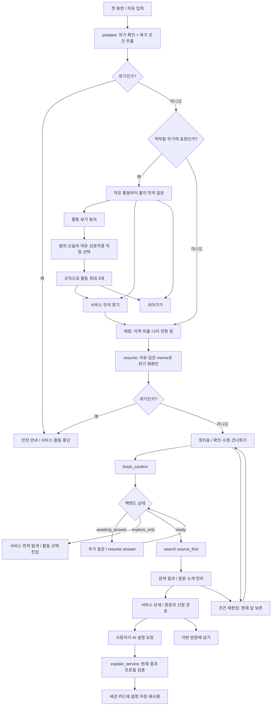
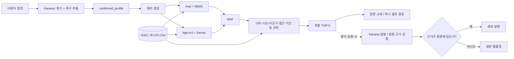
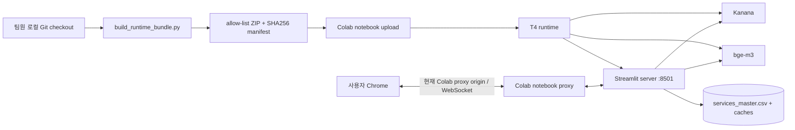
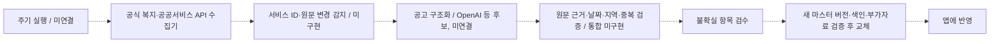

# Streamlit 기술 구조도

기준일: 2026-11-17. 실선은 현재 연결, 별도 ‘미구현’ 도식은 향후 요구다. 실행 방법은 [인수인계](STREAMLIT_HANDOFF.md) 참조.

## 화면·대화 흐름



안전 화면에는 사용자가 누르는 연락 링크만 있다. 자동 통화·신고·출동 요청·위치/대화 전송 기능은 없다. 위기 세션에서 메뉴를 눌러도 결과·상세·방문·탐색·활동 화면으로 우회하지 못한다.

## 모델·검색 흐름



UI는 `search(..., explain_mode='source_first')`를 호출한다. 다른 연구·스크립트의 기존 `search(session)`은 AI 설명 5개를 생성하는 기본값을 유지한다. 표시는 빨라져도 초기 추출·위기 확인은 여전히 모델 작업이다.

## 현재 배포 구조



- PC의 localhost 앱과 T4의 실제 모델 앱은 서로 다른 서버다.
- 최종 연결은 cloudflared·OpenAI API·외부 추론 서버를 사용하지 않는다.
- 런타임 종료 시 `/content` 파일과 모델 캐시가 사라질 수 있다.
- `st.cache_resource`로 한 앱 프로세스에서 모델을 재사용한다. 사전 검증은 별도 프로세스 종료 후 화면을 띄워 모델 이중 적재를 피한다.
- Colab proxy는 매번 다시 얻는다. health 응답과 실제 앱 렌더는 별도로 확인한다.

## 상태 계약

| 상태 | 허용 작업 | 검색 |
|---|---|---|
| awaiting_confirm | 확인 조작·memo·finish_confirm | 하지 않음 |
| awaiting_answer | pending 질문에 answer·memo | 하지 않음 |
| ready | 검색·현재 결과 상세 설명 | 허용 |
| explore_only | 직접 탐색, 확인 라운드 다시 열기 | 맞춤 추천 하지 않음 |
| crisis_stop | 정적 안전 안내·새 이야기 | 서비스·활동 차단 |

기존 오류는 정리표 페이지와 backend 상태가 어긋나 ‘새로운 이야기’를 요구하던 것이다. 이제 현재 session의 accepted actions/confirmed_profile을 유지하여 확인 라운드를 다시 연다. 과거 snapshot으로 뒤늦은 답변을 덮어쓰지 않는다.

## 상세 설명 계약

```python
result = pipe.search(session, explain_mode='source_first')
# pending 카드만 사용자가 요청할 때 아래 호출
card = pipe.explain_service(session, result, serv_id)
# UI가 result['cards']의 해당 카드를 교체
```

조건 변경·위기·검색 결과에 없는 ID의 설명 요청은 거부한다. 소개와 생성 설명의 출처 구분은 `explanation_kind`, 생성을 기다리는지는 `explanation_pending`으로 관리한다.

## 자동 갱신 요구 — 아래 흐름은 미구현



현재 `src/collect/collect_welfare.py`, `src/collect/gov24.py`는 공식 API 수집의 시작점이다. 이미 받은 원문 캐시를 재사용하는 동작도 있어 단순 반복 실행만으로 변경 감지가 되리라 가정하지 않는다. ‘AI가 최신 서비스를 알아서 가져온다’고 설명하지 않는다. OpenAI는 공고 구조화에 사용할 수 있는 후보이며, 주기 실행·수집·변경 감지·반영을 대신하는 기능으로 연결되지 않았다.
