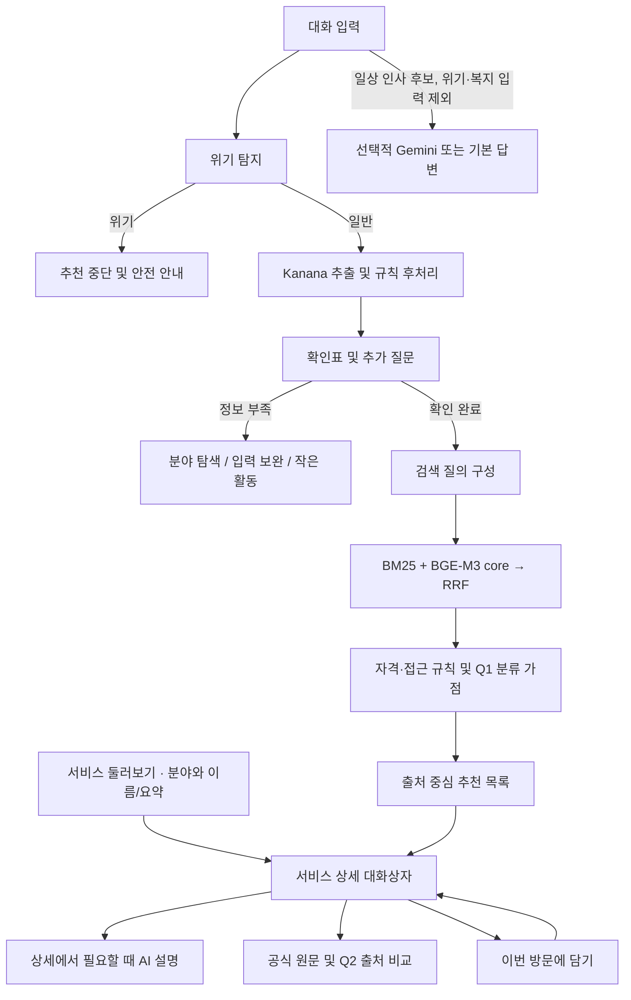

# 반 걸음 Streamlit 인수인계

기준일은 2026-11-18이다. 이 작업 트리는 GitHub `main`의 `9e9fa20f6b5f480c5747cbd5183b0329ff8206fd` 위에 이전 Streamlit 미커밋 변경과 8512 화면 수정본을 합쳤다. 로컬 브랜치는 `codex/streamlit-handoff-20261118`다. 두 채팅의 요청·응답과 턴별 변경 파일은 [작업 기록](STREAMLIT_CHAT_HISTORY.md), 기존 실행 절차는 [런타임 안내](STREAMLIT_RUNTIME.md), 최초 UI와 테스트 계약은 [기존 인수인계](STREAMLIT_HANDOFF.md)에 있다. 이 문서가 버전과 검증 상태의 최신 기준이다.

## 설계도



### 화면과 상태

| 화면 | 동작과 구현 |
| --- | --- |
| 시작·대화 | 예시 문장은 반 걸음 말풍선과 입력창 사이. 이름·연락처 및 외부 AI 안내는 입력창 주변 작은 보조 문구. 새 대화 묶음은 최신 사용자 입력 쪽으로 이동하고, 사용자가 직접 스크롤하면 자동 위치 조정을 중단한다. |
| 정리표·추가 질문 | 추출값을 사용자가 확인·수정할 수 있다. 추가 질문 상태를 화면 전환 뒤에도 이어간다. 추천 이후 조건 수정은 확인 스냅샷으로 돌아간다. |
| 정보 부족·작은 활동 | 추가 입력, 필요 분야 탐색, 정리표로 이어진다. 작은 활동은 동의 흐름을 거쳐 제안하며 위기 중단 상태에서는 표시하지 않는다. |
| 위기 | 추천 중단 후 정적 안내와 도움 연락 경로를 표시한다. |
| 추천 결과 | 독립 화면 상단에서 시작한다. 결과 목록을 먼저 표시하고 모델 설명은 개별 상세 요청 시 생성한다. 결과 없음, 모두 제외, 오류 상태를 각각 처리한다. |
| 서비스 둘러보기 | 서비스 마스터의 Q1 핵심 분야, 이름·요약 문자열로 탐색한다. 표시 건수와 최대 20개 노출을 안내한다. 본문 760px 이하에서 4열이 2열로 전환되고 검색창은 두 칸을 사용한다. 끝의 돋보기는 장식이며 기본 검색 제출은 Enter다. |
| 상세 | 추천·둘러보기·이번 방문에서 같은 대화상자를 열 수 있다. 뒤쪽 목록의 스크롤을 유지한다. 공식 링크, 담기, Q2 근거를 제공한다. 카드 소개는 세 줄로 줄이며 반복 문구를 제거했다. |
| 이번 방문 | 현재 세션에 담은 서비스에 카드별 체크박스, 전체 선택, 삭제 버튼 한 개를 제공한다. 체크한 서비스만 삭제한다. |
| 메뉴·레이아웃 | 밝은 테마와 아이콘 글꼴, 본문 대비 및 줄 간격을 정리했다. 좁은 화면에서는 상단 메뉴를 사용한다. 홈 본문·안내 카드, 상단 위치 표시, 방문 건수 배지가 좁은 너비에서도 별도 공간을 확보한다. |

화면과 상태 전환은 [app.py](../ai/app.py), 글자와 레이아웃은 앱의 CSS 및 [ui_responsive.css](../ai/ui_responsive.css), 스크롤은 [ui_scroll.js](../ai/ui_scroll.js), 작은 활동은 [small_activities.py](../ai/small_activities.py)에 있다.

### 연결 계약

- [pipeline.py](../ai/pipeline.py)의 `prepare(text, profile)`로 위기·추출·초기 확인 상태를 구성하고, `resume(session, action)`으로 답변과 수정 내용을 적용한다. `search(session, explain_mode="source_first")`로 목록을 만들고 `explain_service(session, result, serv_id)`로 현재 결과의 상세 한 건을 생성한다.
- [config.yaml](../ai/configs/config.yaml), [models.py](../ai/core/models.py)의 모델은 `kakaocorp/kanana-2-3b-instruct`와 `BAAI/bge-m3`다. Kanana 위기 프롬프트, 나이 보정, JSON 재시도 생성 길이 확대가 기존 동작에 포함된다. 방문 부담의 `~서` 절 분리 수정 `feb5e5e`는 최신 기준에 병합됐다. 재현 문장 “직접 찾아가서 상담받는 건 부담스러워요.”에서 방문 부담을 확인한다.
- 검색은 BM25와 BGE-M3 `core` 문서 임베딩을 RRF 1:1로 결합한다. 지역·나이·접근성 등 확인 조건을 규칙에 적용한다. 관련성 오류는 입력 해석, 확인 조건, 질의 구성, 검색 순위, 규칙, 원본 데이터 순으로 분리해 재현한다.
- 기준 데이터는 `data/processed/services_master.csv` 5,288건이다. 초기 진단에서 3,312건의 Q1 분야가 `N`이었고 노동·미래설계 라벨 공백이 있었다. 현재 실행은 생성된 Q1 검수 JSON을 원본 위에 연결해 사용한다. 노동 4건, 미래설계 8건이며 최신 Q1 기준 교육·훈련 159건을 브라우저에서 확인했다.
- GitHub `03e5be7` (#111)이 확정 Q1 분류 정책을 적용한다. [q1_recommendation.py](../src/gap_index/q1_recommendation.py)가 `q1-final-policy-20261118`의 분야·가점용 메타데이터를 생성한다. [review_data.py](../ai/core/review_data.py)는 서비스 마스터 해시와 ID로 연결 데이터를 검증한다.
- Q2 연결은 동일 사업 38건, 6개 항목 228개 비교 근거다. 나이·소득·신청 경로·신청 기간·서류·문의처를 두 출처의 원문과 링크로 보여 준다. 수집 시점과 현재 모집 상태를 구분하며 공식 신청 조건은 원문을 기준으로 확인한다.
- [runtime_state.py](../ai/runtime_state.py)와 [prepare_runtime.py](../ai/scripts/prepare_runtime.py)가 입력 파일 버전과 Q1/Q2 생성 파일을 관리한다. 코드·설정·데이터 갱신 후 서버를 재시작한다. 설정·데이터 버전이 바뀌면 이전 검색 세션을 초기화한다. 검색 색인은 데이터와 모델 지문을 검증한다.
- Q3 독립 평가·최종 보고 변경은 기준 Git 이력에 포함된다. 모델 실행 파일과 운영 설정에서 모델 교체는 확인되지 않았다. 평가 수치는 해당 평가 데이터와 보고서 기준이다.

## 변경 이력

| 기준 | 반영 내용 |
| --- | --- |
| #87, `f2cbbb5`, `815d380` | 참고 HTML 흐름으로 Streamlit 전환, Pipeline 연결, 테마·말풍선·사이드바·아이콘·추가 질문 수정 |
| `483b5d8`, `5db7319` | 둘러보기·정보 부족·위기 화면, 실제 T4 실행 자료와 목록 우선 방식 |
| `ea9bceb`, `c33f0ee`, `3344715`, `4018e56` | 빈 값 처리, Gemini 일상 대화, GitHub Colab 노트북, Gemini 키 선택 |
| UI 브랜치 `4235700` | 글자 크기·대비, 상세 대화상자, 스크롤 보존, 담기 동작. 이전 채팅에서 원격에 반영된 커밋이다. 이후 작업은 사용자가 직접 커밋·푸시하기로 했다. |
| 이전 채팅의 로컬 작업 | 방문 부담 후처리 병합, 최종 Q1/Q2 생성과 검증, 런타임 캐시 버전, Colab 두 경로, API 역할 정리, 작은 활동·스크롤·예시·읽기 크기·선택 삭제의 UI 작업 및 테스트 |
| `26df8e6`, `03e5be7`, `9e9fa20` | Q3 최종 평가 문서, Q1 확정 분류, 방문 부담 수정이 `main`에 포함됨 |
| 8512 최신 미커밋 UI | 실제 본문 너비 기반 반응형 그리드, 줄바꿈·상단 배치·방문 건수 배지 개선, 우측 돋보기 |

## 로컬 재현

저장소 루트에서 실행한다. `prepare_runtime.py`는 이 브랜치의 생성기로 Q1과 Q2를 만들고 스키마와 서비스 ID를 확인한다. 기존 CSV에 연결해 사용할 JSON은 생성 산출물이다.

```powershell
python -m pip install -r ai/requirements-test.txt
python ai/scripts/prepare_runtime.py
$env:BANGEOL_PIPELINE_MODE = '실제 흐름(가짜 모델)'
$env:BANGEOL_REQUIRE_REVIEW_DATA = '1'
Push-Location ai
python -m streamlit run app.py --server.address 127.0.0.1 --server.port 8512 --server.headless true
Pop-Location
```

`http://127.0.0.1:8512/?dev=1`에서 모드, 데이터 연결과 오류를 확인한다. `/_stcore/health`는 웹 서버 응답이며 모델 적재는 화면과 별도 점검으로 확인한다. 화면만 확인하는 시연용 가짜 모드, 실제 데이터·검색 흐름과 Mock LLM/임베딩을 쓰는 실제 흐름(가짜 모델), 실제 모델의 세 모드를 구분한다.

## Colab 두 경로

1. [GitHub 노트북](../ai/notebooks/streamlit_colab_github.ipynb)은 T4 선택 → 설정 → 원격 코드 받기 → 설치·검수 데이터 생성 → 실제 모델 점검(선택) → 앱 실행 순으로 실행한다. 기본 `BRANCH`는 `main`이다. 병합 전 화면을 확인하려면 `feat/streamlit-ui`를 지정한다. 마지막 코드 셀에서는 합성 인사에 대한 Gemini 응답 여부와 소요 시간을 확인한다.
2. [ZIP 노트북](../ai/notebooks/streamlit_t4.ipynb)은 로컬 변경도 실행할 수 있다. 위에서 검수 데이터를 생성하고 `python ai/scripts/build_runtime_bundle.py --output bangeol-real-ai.zip`로 새 ZIP을 만든다. T4에서 설정 → ZIP 업로드 → 설치 → 점검(선택) → 앱 실행 순으로 진행한다. 8512 반영 전 저장한 기존 ZIP은 이 문서의 최신 UI 및 Q1 기준보다 이전 버전이다.
3. 런타임이 끊기면 GPU·설정부터 다시 실행한다. [colab_launch.py](../ai/scripts/colab_launch.py)는 이전 앱 프로세스를 교체하고 인증된 Colab 프록시에서 화면을 연다. 과거 공개 터널 시연 주소에는 실제 개인정보 입력을 피한다. 실제 모델 점검 셀은 적재 시간과 GPU 메모리, 첫 실행과 재사용 실행의 입력 해석·확인·추가 응답 처리·목록 검색·상세 설명 생성 시간을 각각 기록한다. 목록 검색 시간은 브라우저 렌더링을 포함하지 않는다.

## API와 키

| 이름 | 역할과 상태 |
| --- | --- |
| `GEMINI_API_KEY` | [chitchat.py](../ai/chitchat.py)의 짧은 일상 대화. 위기·복지 문장은 Gemini 대상에서 제외한다. 키 누락·호출 실패 시 기본 답변을 사용한다. |
| `GH_TOKEN` | 비공개 GitHub를 Colab에서 읽는 데 사용한다. 런타임 모델과 별개다. |
| `CENTRAL_KEY`, `LOCAL_KEY` | 공공데이터포털 중앙부처·지자체 복지서비스의 수집·갱신에 사용한다. 기존 수집기는 Decoding 키를 사용한다. |
| `GOV24_API_KEY` | 보조금24 수집·Q2 비교 근거 갱신에 사용한다. 기존 수집기는 Encoding 키를 사용한다. |
| Kanana·BGE-M3 | Colab에서 직접 적재한다. 현 구조에서는 별도의 모델 호출 API 키가 필요 없다. |
| OpenAI | 과거 공고 구조화 후보. 현재 실행 경로에 호출이 없다. |

Gemini 설정 당시 Google AI Studio 로그인까지 확인됐다. API 호출 예제를 실행할 필요 없이 키 관리 화면에서 키를 만들고, Colab 왼쪽 **보안 비밀**에 `GEMINI_API_KEY`로 저장한 뒤 노트북 접근을 켠다. 설정 셀과 실행 셀을 다시 실행해 “안녕하세요”로 확인한다. API 키 값은 개인 보안 비밀에 둔다. 공공 데이터 자동 갱신에는 수집·변경 감지·데이터 검증·색인 갱신 연결이 추가로 필요하다. 기존 CSV로 추천하는 데 공공 키는 필요 없다. 세부 발급 링크와 당시 Notion 근거는 [작업 기록](STREAMLIT_CHAT_HISTORY.md)에 있다.

## 검증 기록과 남은 확인

- 이전 채팅 기록에는 가독성·상세 창 31개, UI·스크롤 작업 36개, 반응형·삭제 21개 테스트 통과가 남아 있다. 확대 회귀 156개 중 Windows 경로 한 건은 별도 수정·재실행에서 통과했다. 서로 다른 시점과 범위의 기록이다.
- 이전 로컬 실제 흐름에서 검색·개별 설명·위기 중단과 Q2 상세 비교를 확인했다. 8512 최신 작업에서 Q1 5,288건 재생성, 방문 부담 테스트 5개 통과, 서버 health 200을 확인했다.
- 8512 최신 작업에서 Chrome 1366×768, 1280×720, 1024×768, 390×844로 둘러보기 버튼을 검사했다. 각각 4·4·2·2열이었고 검사한 버튼 텍스트에서 가로·세로 넘침이 없었다. 돋보기 표시와 “청년” 입력 후 Enter로 결과 갱신을 확인했다.
- `main`의 `fe1d7aa`에서 Colab T4 실제 추론과 Streamlit 서버 시작을 검증했다. 초기 준비 367.76초, 입력 해석 10.86초, 목록 검색 0.13초, GPU 최대 할당 8.67 GiB였다. 런타임 재연결 후 브라우저 홈과 실제 모델 배지를 확인했다. 입력창 아래 안내 문구 겹침, 팀원 계정 재현, 브라우저 추천 흐름, 상세 설명·Gemini 응답 및 지역·나이·오류 화면은 추가 점검이 필요하다. [T4 검증 상세](STREAMLIT_VERIFICATION.md#2026-11-18-최신-합본-t4-검증)
- 합본 작업 트리에서 런타임·UI·삭제·추출 Python 테스트 23개, 평가 동결·결과 분해 Python 테스트 10개와 스크롤 Node 테스트 3개가 통과했다. 평가 동결 기록의 프롬프트 경로 구분자에 이전 작업의 Windows 보정을 포함했다.
- 새 작업 트리에서 `prepare_runtime.py`를 실행해 Q1 5,288건과 Q2 38건·228개 항목을 재생성하고 마스터와의 연결을 검증했다. ZIP 생성기가 실행 파일과 연결 데이터를 묶고 각 항목의 해시를 검증하는 것도 확인했다.
- 운영 합의로 남은 항목은 분야 라벨 표기 통일, 복지 데이터 갱신 주기와 책임, 시연 방식이다.

## GitHub 반영 범위

작업 트리의 Streamlit 코드·설정·테스트·실행 노트북과 이 인수인계 문서를 검토한다. Q1/Q2 JSON, ZIP, 색인 캐시, 로그는 위 절차로 생성한다. 기존 저장소의 `AGENTS.md` 및 `CONTRIBUTING.md`의 팀 브랜치·PR 흐름을 따른다. 이 인수인계 작업에서는 로컬 브랜치에 코드와 문서를 준비했다.

별도 작업 트리를 전달받기 어려우면 텍스트 패치 `bangeol-streamlit-handoff-20261118.patch`를 사용한다. 위 기준 커밋에서 만든 깨끗한 작업 브랜치의 루트에 적용한다.

```powershell
git apply --check <패치-경로>
git apply <패치-경로>
git status --short
```

초기 팀 이관용 이미지 파일명은 `connected-preview.jpg`, `ui-layout-preview.jpg`, `readability-visit.jpg`다. 당시 화면 기록은 두 채팅의 응답에서 확인할 수 있으며, 최신 화면은 위 로컬 실행 절차로 재현한다.
